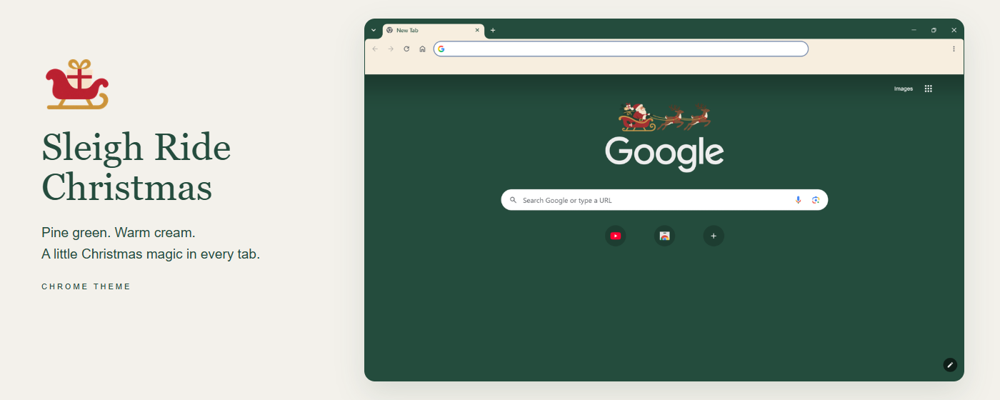
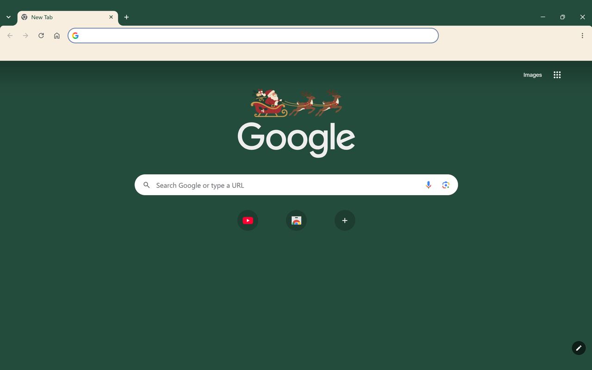
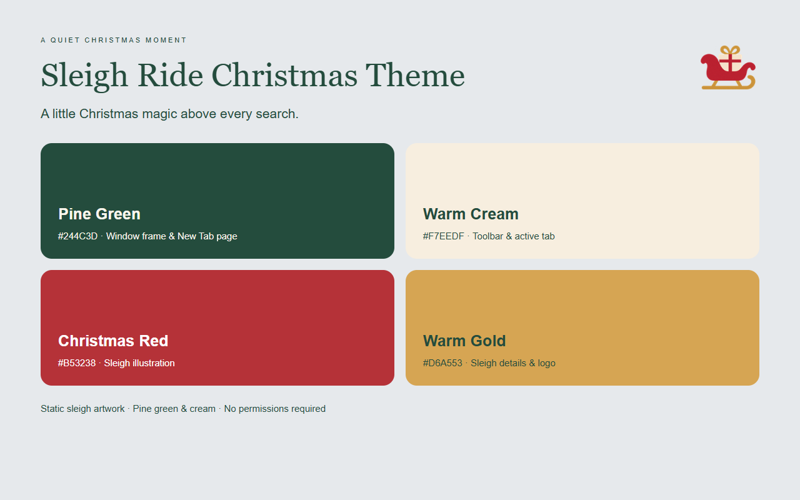

<p align="center">
  
</p>

<h1 align="center">Sleigh Ride Christmas Theme</h1>

<p align="center">
  A calm pine-green Christmas theme with a cream toolbar and a Santa sleigh above the native Google wordmark.
</p>

<p align="center">
  
  
  
  
</p>

<p align="center">
  
</p>

## Overview

Sleigh Ride is a quiet kind of Christmas: a deep pine window frame, a warm cream toolbar, and a spacious green New Tab Page where Santa and two reindeer ride above Chrome's own Google wordmark. The artwork is static — no animation, no scripts, no permissions — and the light text stays readable against the green.

Unlike the solid-colour themes in this collection, this one is a **wallpaper theme**: the New Tab artwork is a pair of ordinary and high-DPI PNGs referenced by `manifest.json`, so the sleigh scene stays crisp on retina displays.

## Design Concept

| Color | Hex | RGB | Role |
|---|---|---|---|
| Pine | `#244C3D` | 36, 76, 61 | Frame, bookmark text, New Tab base |
| Cream | `#F7EEDF` | 247, 238, 223 | Toolbar |
| Ivory | `#FBF6ED` | 251, 246, 237 | Active tab text, New Tab text |
| Red | `#C0392B` | 192, 57, 43 | Sleigh and gift accents in the artwork |

Three choices keep it from looking like a generic holiday theme:

1. **The frame is pine, not red** — red appears only inside the artwork and the icon, so the browser chrome stays calm.
2. **The Google wordmark is Chrome's own** — the sleigh sits above it; the theme never paints a fake logo.
3. **The background ships at both 1x and 2x** — `images/background.png` and `images/background@2x.png`, aligned to the top and not tiled.

## Features

- Static Christmas artwork: Santa, two reindeer and a sleigh above the native Google logo
- Pine-green frame with a warm cream toolbar
- Crisp on high-DPI screens (separate 1x and 2x background PNGs)
- Light New Tab text on green, dark text on cream
- No scripts, no permissions, no data collection

## Screenshots

| Browser | Introduction |
|:-:|:-:|
|  |  |

The browser screenshot keeps the real installed Chrome window: tab strip, address bar and native interface. Personal bookmarks, extension icons and avatars are covered with matching background colors, and the page is scaled proportionally and padded with theme green so nothing personal is shown. The store generator deliberately preserves this native screenshot instead of overwriting it.

## Installation

### Load unpacked (development)

1. Download or clone this repository.
2. Open `chrome://extensions` in Chrome.
3. Enable **Developer mode** in the top right.
4. Click **Load unpacked** and select this folder (`sleigh-ride-christmas-theme`).
5. The theme is active immediately.

### Package for the Chrome Web Store

```
py -3 scripts/package.py
```

This writes two archives next to the project:

| Archive | Contents | Use |
|---|---|---|
| `sleigh-ride-christmas-theme-<version>-upload.zip` | `manifest.json`, `images/`, `logo/` | Upload to the store |
| `sleigh-ride-christmas-theme-<version>.zip` | Everything above plus `scripts/`, `source/`, `store-assets/` and `README.md` | Full backup |

## Store listing copy

Ready to paste into the store listing (also kept in `store-assets/store-description.txt`):

**Summary**

> A calm pine-green Christmas theme with Santa's sleigh, a warm cream toolbar, and a little holiday magic above every search.

**Description**

> Bring a quiet Christmas moment to Chrome. A pine-green window frame pairs with a warm cream toolbar, while Santa and two reindeer ride above the native Google wordmark on a spacious green new tab page.
>
> Static festive artwork, a simple red sleigh icon, and clear light text keep the holiday palette calm and readable. No scripts, no permissions, and no data collection.

## Project structure

| File | Purpose |
|---|---|
| `manifest.json` | Theme definition (inlined `theme` field, wallpaper images, 1x/2x) |
| `images/background.png` | New Tab artwork, 1x |
| `images/background@2x.png` | New Tab artwork, 2x |
| `logo/logo128.png` | 128×128 store icon — a red sleigh carrying one gift |
| `store-assets/promo/440x280.png` | Small promo tile |
| `store-assets/promo/1400x560.png` | Marquee promo tile |
| `store-assets/screenshots/en/screenshot-1-browser.png` | Cleaned real-browser screenshot (1280×800) |
| `store-assets/screenshots/en/screenshot-2-introduction.png` | English HTML/CSS introduction (1280×800) |
| `store-assets/store-description.txt` | Store listing copy |
| `scripts/generate-store-assets.py` | Regenerate icon and store artwork (Pillow + Playwright + installed Chromium) |
| `scripts/prepare-native-screenshot.py` | Clean the real screenshot (cover personal data, scale and pad) |
| `scripts/package.py` | Build the upload zip and the full backup zip |
| `source/` | Original high-resolution artwork (local only, not committed) |
| `logo-candidates/` | Logo contact sheet and alternate concepts (local only, not committed) |

## Regenerating assets

```bash
py -3 scripts/prepare-native-screenshot.py   # clean the native browser screenshot
py -3 scripts/generate-store-assets.py       # icon + promo + introduction
py -3 scripts/package.py                     # both 1.0.0 zips
```

`generate-store-assets.py` uses Pillow plus Playwright with the locally installed Chromium. The icon itself was produced with the built-in image generator from the selected concept — a standalone transparent red sleigh with a cream gift, gold bow and runners — and only the exported `logo/logo128.png` is needed at runtime.

## License

Sleigh Ride Christmas Theme is released under the Non-Commercial License. See `LICENSE` for full text (English / 中文).
